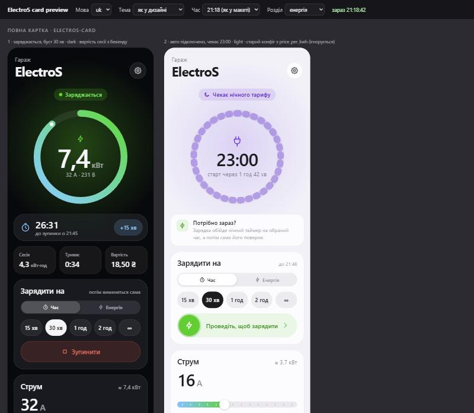
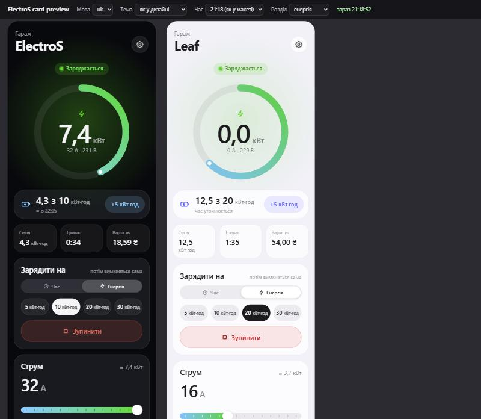
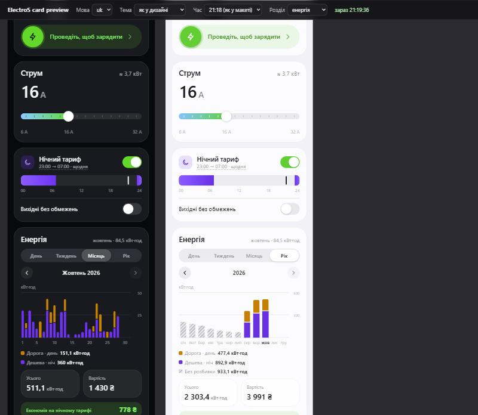
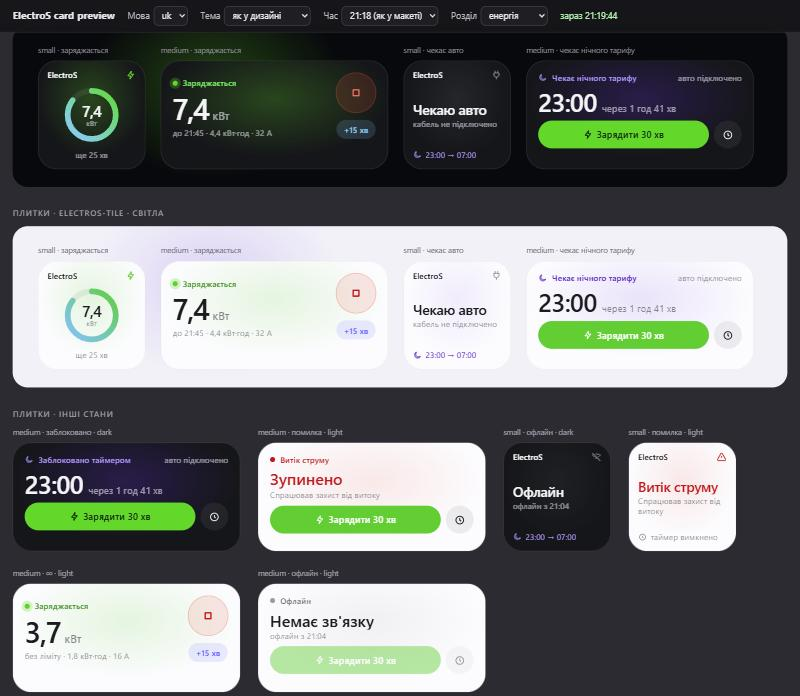

# Струм — розумна зарядка ElectroS

**Струм** — інтеграція Home Assistant і картка для Wi-Fi зарядок електромобілів ElectroS.

[](https://github.com/hacs/integration)

Інтеграція Home Assistant для Wi-Fi зарядок **ElectroS** (хмара [electros.org.ua](https://electros.org.ua) або напряму в локальній мережі): стан і вимірювання, нічний таймер під керуванням HA, «зарядити зараз» на N хвилин або N кВт·год, двозонний тариф із вартістю, статистика й картка Lovelace для телефона.

[English version below](#english)






<sub>Скриншоти зі сторінки попереднього перегляду `dev/card-preview.html` на тестових даних.</sub>

## Що додає v2

Версія 2 — розвиток інтеграції [podzolkov/electros-ev-ha-from-andriy](https://github.com/podzolkov/electros-ev-ha-from-andriy):

- **Нічний таймер з HA**: перемикач і час початку/кінця, режим «вільні вихідні»; HA пише таймер на зарядку лише тоді, коли щось змінилося, і приймає зміни з вебпанелі electros.
- **Зарядити зараз** на N хвилин (`charge_for`) або до N кВт·год (`charge_energy`), подовжити, зупинити; після цього нічний таймер повертається сам.
- **Двозонний тариф**: ціни дня й ночі, розподіл енергії по зонах, вартість, поточна ціна для панелі «Енергія».
- **Нові сенсори**: енергія (лічильник), потужність із зарядки, енергія сесії та місяця, коли закінчиться зарядка.
- **Картка `electros-card` і плитки `electros-tile`**, зроблені під телефон: кільце потужності, швидкі кнопки, статистика День · Тиждень · Місяць · Рік.
- Напруга тепер поточна (поле 10), а не максимум за період; секрети зі статусу (Wi-Fi, пароль хмари) не потрапляють в HA і в логи.
- Тести без мережі, CI (pytest, hassfest, HACS).

Подяки:

- [podzolkov](https://github.com/podzolkov) — оригінальна інтеграція й розбір хмари electros;
- [nitogel](https://github.com/nitogel) — PR [#1](https://github.com/podzolkov/electros-ev-ha-from-andriy/pull/1) (локальний режим), [#2](https://github.com/podzolkov/electros-ev-ha-from-andriy/pull/2) (статуси 32 і 77), [#3](https://github.com/podzolkov/electros-ev-ha-from-andriy/pull/3) (енергія, потужність із зарядки, скидання кВт·год), увійшли у v2;
- [Huuungry/deye-web-ui](https://github.com/Huuungry/deye-web-ui).

## Встановлення

### HACS (власний репозиторій)

1. HACS → **⋮** (угорі праворуч) → **Custom repositories**.
2. Вставте URL цього репозиторію (з адресного рядка, наприклад `https://github.com/podzolkov/electros-ev-ha-from-andriy`), тип **Integration** → **Add**.
3. Знайдіть **Струм — розумна зарядка ElectroS** → **Download**.
4. Перезапустіть Home Assistant.

### Вручну

1. Скопіюйте `custom_components/electros_ev/` у `config/custom_components/` вашого HA.
2. Перезапустіть Home Assistant.

Потрібно: Home Assistant **2024.11** або новіший (автотести проходять на 2026.2.3), зарядка, зареєстрована на electros.org.ua.

### Налаштування

**Налаштування → Пристрої та служби → Додати інтеграцію → Струм — розумна зарядка ElectroS**:

| Поле | Що вписати |
|---|---|
| Логін (назва пристрою) | логін зарядки на electros.org.ua (номер виробу) |
| Пароль хмари | пароль від electros.org.ua; не потрібен, якщо задано локальну адресу |
| Локальна IP-адреса | необов'язково: IP зарядки у вашій мережі (тоді хмара не використовується) |
| Інтервал оновлення | 30–600 с, типово 60 |

Пізніше в **Налаштування → Пристрої та служби → ElectroS → Налаштувати** можна змінити локальну адресу, інтервал і **нічну зону тарифу** (типово 23:00–07:00). Після збереження інтеграція перезавантажується.

### Хмара чи локальний режим

- **Хмара** (типово): перед кожним запитом HA входить на electros.org.ua і говорить із зарядкою через `wss://electros.org.ua/ws/`. Потрібен інтернет і пароль; команди виконуються з невеликою затримкою.
- **Локально**: `ws://<IP зарядки>/ws`, порт 80, без входу і без хмари (так працював PR #1). Швидше й не залежить від інтернету, але на нашій зарядці ще не перевірено; зарядці бажано дати постійну IP-адресу в роутері. Скидання лічильника кВт·год у локальному режимі теж іде напряму.

Деталі протоколу — [docs/protocol.md](docs/protocol.md).

## Сутності

Home Assistant будує id з англійських назв (навіть в українському інтерфейсі): `<домен>.electros_<login>_<назва>`, де `<login>` — ваш логін малими літерами. Якщо ви оновилися з v1.x, старі сутності зберігають свої id.

### Сенсори

| Сутність | Що показує |
|---|---|
| `sensor.electros_<login>_status` | стан: `waiting_for_vehicle`, `vehicle_connected_idle`, `charging`, `charging_blocked` (у т. ч. таймером), `charging_fault`, `mains_voltage_low`, `charger_communication_fault`, `leakage_current_fault`, `overcurrent_fault` (понад 40 А), `offline`, `unknown`; атрибути `status_code`, `online`, `device_time`, `events` (журнал зарядки) |
| `sensor.electros_<login>_configured_current` | заданий на зарядці струм, А |
| `sensor.electros_<login>_measured_current` | виміряний струм, А |
| `sensor.electros_<login>_mains_voltage` | напруга мережі зараз, В; атрибути `min`, `max`, `avg` |
| `sensor.electros_<login>_charging_power` | потужність зарядки, Вт (з самої зарядки) |
| `sensor.electros_<login>_consumed_energy` | лічильник кВт·год від останнього «Reset кВт» (`total_increasing`, для панелі «Енергія») |
| `sensor.electros_<login>_session_energy` | кВт·год поточної/останньої сесії; атрибути `started_at`, `cost`, `history` (сесії із зарядки) |
| `sensor.electros_<login>_energy_this_month` | кВт·год цього місяця із зарядки; атрибути `months` (січень…грудень), `current_month` |
| `sensor.electros_<login>_boost_ends` | коли закінчиться «зарядити зараз»: кінець для часу, **оцінка** для кВт·год, `unknown` для ∞; атрибути `active`, `mode` (`time`/`energy`/`unlimited`), `unlimited`, `minutes`, `target_kwh`, `delivered_kwh`, `deadline`, `last_error` |
| `sensor.electros_<login>_energy_day_tariff` | кВт·год за денним тарифом від встановлення (`total_increasing`) |
| `sensor.electros_<login>_energy_night_tariff` | кВт·год за нічним тарифом від встановлення (`total_increasing`) |
| `sensor.electros_<login>_energy_cost` | накопичена вартість у валюті HA (`monetary`, `total`) |
| `sensor.electros_<login>_current_price` | ціна кВт·год зараз (`<валюта>/kWh`); атрибути `zone` (`day`/`night`), `night_start`, `night_end` |

### Керування

| Сутність | Що робить |
|---|---|
| `switch.electros_<login>_charging` | увімк. — заряджати зараз (якщо таймер забороняє — без обмеження часу, ∞); вимк. — стоп, скасувати буст, повернути таймер |
| `switch.electros_<login>_night_timer` | чи діє нічне вікно на зарядці; атрибут `device_window` — що зараз записано на зарядці |
| `switch.electros_<login>_free_charging_on_weekends` | «вільні вихідні»: у суботу й неділю таймер вимкнений |
| `time.electros_<login>_night_window_start`, `time.electros_<login>_night_window_end` | початок і кінець нічного вікна зарядки |
| `number.electros_<login>_charging_current` | струм 6–32 А крок 2; під час зарядки застосовується одразу |
| `number.electros_<login>_boost_duration` | хвилини для кнопки «зарядити зараз» (5–480) |
| `number.electros_<login>_boost_kwh` | кВт·год для кнопки «зарядити енергію» (1–80, типово 10) |
| `number.electros_<login>_price_day`, `number.electros_<login>_price_night` | ціна кВт·год дня й ночі (0–100, крок 0,01; типово 4,32 і 2,16) |
| `button.electros_<login>_charge_now_boost` | зарядити зараз на `boost_duration` хвилин |
| `button.electros_<login>_charge_energy_boost` | зарядити зараз до `boost_kwh` кВт·год |
| `button.electros_<login>_reset_kwh` | скинути лічильник кВт·год на зарядці |

Коли зарядка недоступна, живі значення стають `unavailable`, а налаштування (таймер, ціни, струм, хвилини/кВт·год), `boost_ends` і тарифні лічильники лишаються доступними.

### Сервіси

Усім потрібен `device_id` зарядки. У YAML його зручно брати з будь-якої сутності: `device_id: "{{ device_id('sensor.electros_<login>_status') }}"`.

| Сервіс | Поля | Що робить |
|---|---|---|
| `electros_ev.charge_for` | `minutes` 1–1440, `amps`? 6–32 | зарядити зараз N хвилин, оминаючи таймер |
| `electros_ev.charge_energy` | `kwh` 0,5–100, `amps`? 6–32 | зарядити зараз, доки не буде передано N кВт·год |
| `electros_ev.extend_charge` | рівно одне: `minutes` 1–1440 або `kwh` 0,5–100 | додати до поточного бусту; якщо такого немає — почати новий |
| `electros_ev.stop_charging` | — | стоп, скасувати буст, повернути таймер |
| `electros_ev.set_timer` | хоча б одне: `start`, `end` (HH:MM), `enabled` | змінити нічне вікно і/або ввімкнути чи вимкнути його |

`amps` стає новим струмом зарядки (непарне значення округлюється вниз до кроку 2 А). Помилки: неправильні дані або чужий пристрій — повідомлення валідації; зарядка не прийняла команду — `command_failed`.

## Як це працює

### Нічний таймер

На зарядці є **одне щоденне вікно** `HH:MM–HH:MM`, у якому вона може заряджати (наприклад, 23:00–07:00 під нічний тариф). HA зберігає бажані налаштування (перемикач, час, «вільні вихідні») і пише вікно на зарядку **лише при змінах**: коли ви щось змінили, на початку й наприкінці бусту, щодня о 00:00:05 (межа вихідних) і один раз після старту HA, якщо треба. Звичайні опитування нічого не пишуть. Кожен запис таймера заодно ставить годинник зарядки за місцевим часом HA.

### «Зарядити зараз» на N хвилин

`charge_for`, кнопка `charge_now_boost` або чіп у картці: якщо таймер увімкнений — HA вимикає його, чекає ~3 с і дає старт. Наприкінці — стоп і повернення таймера. Але якщо в момент кінця нічне вікно і так дозволяє зарядку, **стоп не надсилається**: таймер повертається, і зарядка триває за розкладом. `extend_charge {minutes}` подовжує; новий чіп під час зарядки задає новий час.

**∞**: `switch.charging` увімкнений, коли таймер забороняє, — зарядка без обмеження: таймер вимкнений, доки зарядка не припиниться (авто заряджене або від'єднане; якщо за 15 хв зарядка так і не почалася — теж). Увімкнення ∞ під час бусту на час або кВт·год перетворює його на безлімітний.

### «Зарядити на N кВт·год»

`charge_energy`, кнопка `charge_energy_boost` або режим «Енергія» в картці. Старт такий самий. HA рахує енергію, передану від старту (сума приростів лічильника між опитуваннями, тож «Reset кВт» посеред зарядки нічого не ламає), опитує зарядку кожні 20 с і на цілі зупиняє зарядку й повертає таймер — навіть усередині нічного вікна. `extend_charge {kwh}` збільшує ціль.

Страховий термін: `старт + ціль / (струм × 0,23 кВт) × 1,5 + 30 хв`. Якщо до нього ціль не досягнуто — стоп і `last_error = energy_deadline`. `boost_ends` показує оцінку кінця (залишок ÷ поточна потужність) і `unknown`, поки потужність 0.

### Вихідні та зміни у вебпанелі

- **Вільні вихідні**: у суботу о 00:00:05 HA вимикає таймер, у понеділок о 00:00:05 повертає. Буст на час, що закінчується у вільний вихідний, зупиняється (вікна, яке б продовжило зарядку, немає).
- **Зміни у вебпанелі electros або іншому застосунку**: якщо на зарядці з'явилося інше вікно, ніж HA записав востаннє, HA приймає його (перемикач і час у HA оновлюються) і не воює з вами. Винятки: дві хвилини після власного запису HA і час бусту (тоді таймером володіє HA).
- **Після перезапуску HA**: якщо вікно змінили, поки HA був вимкнений, HA приймає його. Пише сам лише тоді, коли на зарядці досі те, що HA записав востаннє, а потрібне інше (наприклад, поки HA не працював, почалися чи закінчилися вихідні).
- **Зарядка офлайн** (статус `offline`, наприклад немає світла, а HA працює від ДБЖ): HA нічого їй не надсилає — команди до неї не дійшли б. Коли зарядка знову на зв'язку, HA записує своє вікно (не приймає те, що залишилося на зарядці) і, якщо вона ще заряджає, надсилає стоп, який мав бути.
- **Стоп не дійшов** (помилка зв'язку або зарядка офлайн): у `boost_ends` `last_error: stop_failed`, і HA повторює стоп на кожному опитуванні, поки зарядка заряджає. Наприкінці бусту на час повтор не потрібен, якщо вже почалося нічне вікно.

### Обмеження

- На зарядці лише одне щоденне вікно; кілька вікон або різні вікна по днях недоступні.
- Бустом керує HA. Якщо HA вимкнений, зарядка йде з вимкненим таймером, а буст закінчиться лише тоді, коли HA знову запрацює.
- Якщо авто перестало брати струм раніше за ціль у кВт·год (батарея повна), буст чекає страхового терміну, і до того часу таймер вимкнений.
- Перший приріст після старту бусту на кВт·год може включати енергію до одного інтервалу опитування до старту, якщо авто вже заряджалося.
- Розподіл на день/ніч і вартість рахуються **від моменту встановлення** v2; історії зарядки до того в них немає. Статистика в картці — теж від встановлення (місяці до того в «Рік» беруться з лічильників зарядки, без розподілу).
- На зарядці не перевірено: що ввімкнення таймера посеред вікна не перериває зарядку; що поле потужності показує 0, коли авто не заряджається; локальний режим.

## Тарифи і панель «Енергія»

- **Нічна зона тарифу** — окреме налаштування інтеграції (типово 23:00–07:00), не таймер зарядки. Початок включно, кінець — ні.
- **Ціни** — `number.electros_<login>_price_day` і `..._price_night`, у валюті HA (**Налаштування → Система → Загальні → Валюта**, для України — UAH; після зміни валюти перезавантажте інтеграцію).
- На кожному успішному опитуванні приріст лічильника відноситься до зони часу опитування. Якщо з попереднього було більше трьох інтервалів (HA не працював), приріст ділиться між зонами пропорційно хвилинам кожної зони; перехід на літній/зимовий час враховано. Поки зарядка офлайн, нічого не рахується (енергія врахується, коли вона повернеться).
- Вартість = кВт·год × ціна зони на той момент; зміна ціни діє лише на подальший облік.

**Панель «Енергія»** (Налаштування → Панелі → Енергія):

- **Окремі пристрої** → `sensor.electros_<login>_consumed_energy` — споживання зарядки на графіках.
- Якщо в зарядки окремий лічильник (або ви хочете бачити вартість зарядки на панелі): **Споживання з мережі** → `sensor.electros_<login>_consumed_energy`, **Використовувати сутність із поточною ціною** → `sensor.electros_<login>_current_price`. HA створить `sensor.electros_<login>_consumed_energy_cost`. Не додавайте зарядку як споживання з мережі, якщо загальний лічильник будинку там уже є, — енергія порахується двічі; тоді вартість зарядки дивіться в картці й у `energy_cost`.

## Картка і плитки

Картку реєструє сама інтеграція (`/electros_ev/electros-card.js` вантажиться на всіх дашбордах), ресурс додавати не треба. **Редагувати дашборд → Додати картку → ElectroS** (або **ElectroS tile**) і виберіть зарядку.

```yaml
type: custom:electros-card
device_id: 0123456789abcdef0123456789abcdef  # id пристрою; простіше вибрати у візуальному редакторі
theme: auto                 # auto | light | dark
quick_minutes: [15, 30, 60, 120]
quick_kwh: [5, 10, 20, 30]  # чіпи режиму «Енергія»
stats_period: week          # day | week | month | year — лише в YAML
charge_mode: time           # time | energy — лише в YAML
```

```yaml
type: custom:electros-tile
device_id: 0123456789abcdef0123456789abcdef
size: medium                # small | medium
quick_minutes: [30, 60]
```

Картка шукає сутності за `device_id` і `translation_key`, тож перейменування сутностей її не ламає. Що вона показує: кільце потужності, зворотний відлік або «4,2 з 10 кВт·год», чіпи «на N хв» / «на N кВт·год» (перемикач **Час | Енергія**), «+15 хв» / «+5 кВт·год», струм, нічний тариф, вартість сесії.

**Статистика**: День · Тиждень · Місяць · Рік зі стрілками ‹ › — стовпчики «дорога» (денний тариф) і «дешева» (нічний), під графіком кВт·год, вартість і економія = нічні кВт·год × (ціна дня − ціна ночі). Дані — довгострокова статистика HA (recorder має бути ввімкнений, тарифні сенсори не виключені з запису); поки її немає — «Статистика накопичується з моменту встановлення». У «Рік» місяці без статистики HA показуються з лічильника зарядки як «без розбивки».

Більше прикладів — [examples/dashboard.yaml](examples/dashboard.yaml).

## З телефона (Home Assistant Companion)

- **Дашборд**: картка зроблена під телефон і в застосунку на iOS і Android працює так само, як у браузері (у самому застосунку на iOS ще не перевірялася). Після оновлення інтеграції потягніть сторінку вниз; якщо картка стара — **Налаштування → Companion app → Налагодження → Скинути кеш інтерфейсу** (iOS) або очистіть кеш застосунку (Android).
- **Сповіщення з кнопками**: [examples/automations.yaml](examples/automations.yaml) — «Авто підключено вдень — зарядити 30 хв / 10 кВт·год?» через `notify.mobile_app_<телефон>` і подію `mobile_app_notification_action`; також «зарядку завершено» з кВт·год і вартістю, помилки й офлайн.
- **Віджети**: скрипти з [examples/scripts.yaml](examples/scripts.yaml) (`script.electros_charge_30_min`, `script.electros_charge_10_kwh`, `script.electros_stop`) додаються як віджети Home Assistant на iOS і Android, у Siri/Shortcuts і на годинник.

## Приклади автоматизацій

[examples/](examples/) — двозонний тариф: сповіщення з кнопками, повідомлення про кінець зарядки з вартістю, стоп після N кВт·год за сесію, помилки й офлайн, «вільні вихідні» з помічника, свята з календаря, кнопки-скрипти. Замініть `es123456` на ваш логін, `notify.mobile_app_phone` — на ваш телефон.

## Якщо щось не так

- **Картки немає в списку / «Custom element doesn't exist»** — перезапустіть HA після встановлення, оновіть сторінку без кешу (Ctrl+F5) або скиньте кеш у Companion app.
- **Не вдається підключитися** — перевірте логін і пароль на electros.org.ua; для локального режиму — що IP відповідає на порту 80 з машини з HA.
- **Після старту статус `charging_blocked`, у `boost_ends` `last_error: charging_blocked`** — зарядка не прийняла старт (таймер усе ще забороняє, авто не готове). Спробуйте ще раз або перевірте авто.
- **Таймер «повертається»** — HA приймає зміни з вебпанелі не раніше ніж через 2 хв після власного запису і не під час бусту.
- **Буст не зупинився вчасно** — HA був вимкнений або без зв'язку; він закінчиться, щойно HA знову побачить зарядку.
- **Статистика порожня** — зачекайте годину (HA рахує погодинну статистику), перевірте, що recorder пише тарифні сенсори; дані — лише від встановлення.
- **Вартість у неправильній валюті** — змініть валюту HA і перезавантажте інтеграцію; якщо HA попередить про зміну одиниць статистики — **Інструменти розробника → Статистика**.
- **Журнал** — у `configuration.yaml` (сирі повідомлення зарядки з паролями Wi-Fi і хмари інтеграція ніколи не пише):

  ```yaml
  logger:
    logs:
      custom_components.electros_ev: debug
  ```

## Застереження

Проєкт **не пов'язаний з ElectroS** і не схвалений нею. Програма надається «як є», без жодних гарантій; автори не відповідають за шкоду, втрату даних, несправність обладнання тощо. Хмарний сервіс electros.org.ua може змінитися будь-коли. Неправильне керування зарядкою може вплинути на зарядку чи авто — перевіряйте поведінку самостійно. Облікові дані зберігаються локально в HA і надсилаються лише на electros.org.ua для входу. Повний текст — в англійському розділі нижче.

Ліцензія — MIT.

---

# English

**Strum** (Ukrainian for "electric current") — smart charging for ElectroS. Home Assistant integration for **ElectroS** Wi-Fi EV chargers (cloud [electros.org.ua](https://electros.org.ua) or directly on the LAN). Version 2 builds on [podzolkov/electros-ev-ha-from-andriy](https://github.com/podzolkov/electros-ev-ha-from-andriy).

## What v2 adds

- Night timer owned by HA (switch, start/end times, free weekends); the charger is written only on changes, and changes made in the electros web panel are adopted.
- Charge now for N minutes (`charge_for`) or until N kWh (`charge_energy`), extend, stop; the night timer is restored afterwards.
- Two-zone tariff: day/night prices, energy split, cost, current price for the Energy dashboard.
- New sensors (energy counter, charger-reported power, session and month energy, boost end), the voltage is the current value (field 10), secrets from the status never reach HA or the logs.
- Lovelace card `electros-card` and tiles `electros-tile` (phone-first) with day/week/month/year statistics.
- Offline tests and CI (pytest, hassfest, HACS).

Thanks to [podzolkov](https://github.com/podzolkov) for the original integration, to [nitogel](https://github.com/nitogel) for PRs #1–#3 (local mode, status codes 32/77, energy, power and kWh reset), and to [Huuungry/deye-web-ui](https://github.com/Huuungry/deye-web-ui).

## Installation

- **HACS**: HACS → ⋮ → Custom repositories → this repository's URL, category *Integration* → Download → restart Home Assistant.
- **Manual**: copy `custom_components/electros_ev/` to `config/custom_components/` and restart.
- Then **Settings → Devices & services → Add integration → Струм — розумна зарядка ElectroS**: charger login, cloud password (optional with a local IP), optional local IP, update interval (30–600 s, default 60). The options flow changes the local IP, the interval and the night tariff zone (default 23:00–07:00).

Requires Home Assistant 2024.11 or newer (the test suite runs on 2026.2.3).

**Cloud vs local**: the cloud mode logs in to electros.org.ua before every request and talks over `wss://electros.org.ua/ws/`; the local mode uses `ws://<charger IP>/ws` on port 80 without any login (not verified on our charger yet). See [docs/protocol.md](docs/protocol.md).

## Entities and services

Entity ids are built from the English names: `<domain>.electros_<login>_<name>`; the tables above list all of them. Sensors: `status`, `configured_current`, `measured_current`, `mains_voltage`, `charging_power`, `consumed_energy`, `session_energy` (attributes `started_at`, `cost`, `history`), `energy_this_month`, `boost_ends` (attributes `active`, `mode`, `unlimited`, `minutes`, `target_kwh`, `delivered_kwh`, `deadline`, `last_error`), `energy_day_tariff`, `energy_night_tariff`, `energy_cost`, `current_price` (attribute `zone`). Controls: `switch` `charging` / `night_timer` / `free_charging_on_weekends`, `time` `night_window_start` / `night_window_end`, `number` `charging_current` / `boost_duration` / `boost_kwh` / `price_day` / `price_night`, `button` `charge_now_boost` / `charge_energy_boost` / `reset_kwh`.

| Service | Fields |
|---|---|
| `electros_ev.charge_for` | `device_id`, `minutes` 1–1440, `amps`? 6–32 |
| `electros_ev.charge_energy` | `device_id`, `kwh` 0.5–100, `amps`? 6–32 |
| `electros_ev.extend_charge` | `device_id`, exactly one of `minutes` / `kwh` |
| `electros_ev.stop_charging` | `device_id` |
| `electros_ev.set_timer` | `device_id`, at least one of `start`, `end`, `enabled` |

## How it works

- **Night timer**: the charger has a single daily window. HA keeps the desired settings and writes the window only on transitions (user changes, boost start/end, the daily 00:00:05 weekend check, once after startup if needed); every write also sets the charger clock.
- **Timed boost**: the timer is disabled (~3 s), charging starts, at the end HA stops and restores the timer — unless the restored night window allows charging at that moment, then charging simply continues. **∞** (charging switch on while the timer blocks) charges until the car stops; ∞ during a timed or energy boost turns it into an unlimited one.
- **Energy boost**: HA adds up the positive counter deltas since the start (a counter reset does not end it), polls every 20 s, stops at the target and restores the timer. Safety deadline `start + target / (amps × 0.23 kW) × 1.5 + 30 min`, then stop with `last_error = energy_deadline`.
- **Weekends and web panel changes**: free weekends disable the timer on Saturday and Sunday. A window changed in the web panel is adopted (not within 2 minutes after HA's own write, not during a boost); at startup HA adopts a window changed while it was down and writes only if the charger still has HA's last value but HA wants another one.
- **Charger offline** (status `offline`, e.g. a power cut while HA runs on a UPS): HA sends it nothing. When it is back, HA writes its window (instead of adopting what the charger kept) and re-sends a stop it still owes if the charger is charging. A stop that did not arrive shows as `last_error = stop_failed` and is retried on every poll while the charger charges (not after a timed boost once the night window has started).
- **Limits**: one daily window; if HA is down a running boost ends only when HA is back; an energy boost whose car stopped early waits for the deadline; the tariff split and the statistics start at installation.

## Tariffs and the Energy dashboard

Prices are `number.electros_<login>_price_day` / `_price_night` in the HA currency; the night zone is an integration option. Each poll's counter delta goes to the zone of the poll time; longer gaps (HA down) are split by zone minutes, DST-aware. For the Energy dashboard add `sensor.electros_<login>_consumed_energy` under *Individual devices*; to get its cost there, add it as *Grid consumption* with *Use an entity with current price* = `sensor.electros_<login>_current_price` (only if the charger has its own meter, otherwise the energy is counted twice).

## Card, phone, examples

The card is registered automatically. YAML options: `electros-card` — `device_id`, `theme`, `quick_minutes`, `quick_kwh`, `stats_period`, `charge_mode`; `electros-tile` — `device_id`, `theme`, `quick_minutes`, `size`. The statistics view reads HA long-term statistics of `energy_day_tariff`, `energy_night_tariff` and `energy_cost`. In the Companion app (iOS/Android) the card works on dashboards; [examples/automations.yaml](examples/automations.yaml) has actionable notifications (`mobile_app_notification_action`), [examples/scripts.yaml](examples/scripts.yaml) has scripts for widgets and dashboard buttons.

## Troubleshooting

Restart HA and hard-refresh if the card is missing; check the cloud login/password or that the local IP answers on port 80; enable `custom_components.electros_ev: debug` logging (raw charger messages are never logged).

## Disclaimer

This project is **not affiliated with, endorsed by, or associated with ElectroS** or any of its subsidiaries.

This software is provided **"as is"**, without warranty of any kind, express or implied. The authors and contributors are **not responsible for any damage, data loss, hardware malfunction, or any other harm** that may result from the use of this integration.

By using this integration you acknowledge that:

- You use it **at your own risk**
- The integration communicates with a third-party cloud service (electros.org.ua) which may change its API at any time without notice
- The authors have no control over the ElectroS service availability or behavior
- Incorrect use of charging controls may affect your EV charger or vehicle — always verify charger behavior independently
- Your credentials are stored locally in Home Assistant and are only sent to electros.org.ua for authentication

## License

MIT
